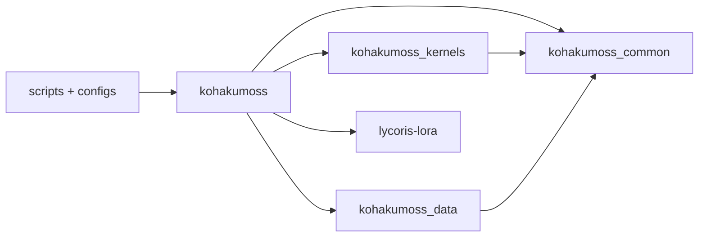
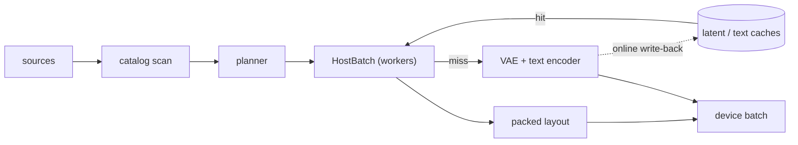
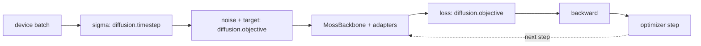
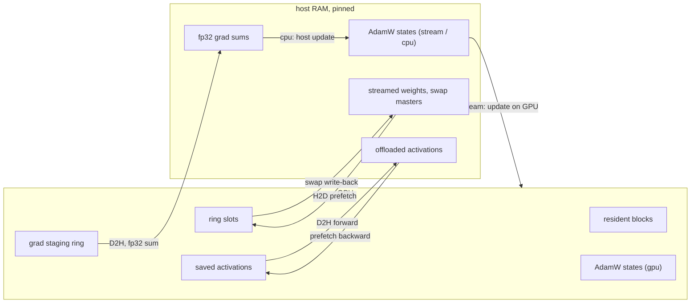
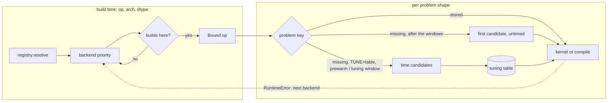
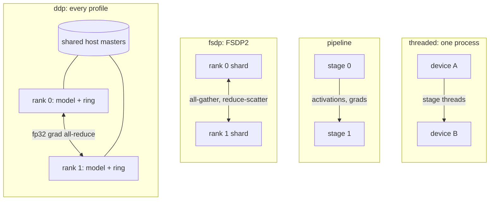

# KohakuMoss

A finetuning framework for [MOSS-Image](https://huggingface.co/OpenMOSS-Team/MOSS-Image-Base)
(MOSS-Image-Base / -SFT): every LyCORIS algorithm and full finetune on text-image data at
native resolutions, plus inference, on Windows and Linux, from 6 GB cards to multi-GPU
nodes.


A style LoRA (rank 8, fp16, fp8 base GEMMs) after 100 steps at batch ~4 (20k tokens per
step) on one RTX 4090, with the aggressive `ckpt-ring4-actoff` offload profile and the text
encoder and VAE encoding online in every step: 12-13 GB on the card, about 0.85 images / s.
Top row MOSS-Image-Base, bottom row the LoRA; 32 sampler steps, CFG 3, the same seed per
column.

- **Adapters and full finetune.** LoRA / LoCon, LoHa, LoKr, DoRA, OFT, BOFT, GLoRA, IA3,
  DyLoRA, T-LoRA through [LyCORIS](https://github.com/KohakuBlueleaf/LyCORIS) (its
  algorithms, save format and fused kernels), with dropouts, LoRA+, bypass or merged
  forwards and targeting presets; full finetune with Muon + AdamW and EMA after the MOSS
  tech report.
- **Own MOSS-Image implementation** on packed variable-length batches (one flat token
  axis, attention stays within each sample), checked against the official code: fp32
  forward relative error 4.7e-6, 50-step sampling LPIPS 2.3e-6.
- **Kernels per GPU arch.** TileLang for sm70 / sm75, Triton for sm80+ and Intel Arc;
  varlen attention, the block ops and fused linears. Each op is bound per arch, dtype and
  shape to the faster of its kernel and `torch.compile`, measured once per card and
  stored in a tuning table.
- **Precision.** bf16, and fp16 for cards without bf16 (with an fp16 residual fix);
  fp8 and MXFP8 compute (sm89+) for the DiT and the text encoder in training and
  inference; int8 / fp8 weight-only frozen bases.
- **Memory profiles** from `speed` to `minimal`, a 240-entry catalog, or manual knobs:
  checkpointing, weight streaming, activation offload, gradient offload, host optimizer
  states. Adapter training fits 8 GB and 6 GB cards; full finetune fits one 24 GB card
  with host masters.
- **Native-resolution data.** kohya / folder / jsonl / parquet / webdataset / native
  shard sources, a cached incremental catalog, resize / bucket / crop planners, token
  batching, offline and online latent / text caches; a plan that is a pure function of
  the data, the seed and the knobs, so a resume replays it exactly.
- **Multi-GPU (Linux).** DDP under every memory profile (weight streaming included),
  FSDP2, pipeline and threaded pipeline.
- **Exports.** LyCORIS files, ComfyUI-format adapters (the key layout of ComfyUI's
  MOSS-Image model, plus its fused q/k/v repack), merged and diffusers transformers.
- **Configs.** Every script is a [KohakuEngine](https://github.com/KohakuBlueleaf/KohakuEngine)
  (`kogine`) script: settings are module-level knobs, configs compose preset layers, and
  `kohakumoss-config` writes a checked config for your GPU and dataset.

## Install

torch comes from the PyTorch index that matches your GPU and driver; the install helper
detects both, installs torch from that index, then KohakuMoss with its default extra,
then runs `kohakumoss-doctor`, which lists anything missing with the command that fixes
it. Requirements: Python 3.10+ (the helpers make a 3.12 venv), an NVIDIA driver for CUDA
12.6+ or the Intel Arc driver; on Windows the Visual Studio Build Tools ("Desktop
development with C++"); for sm70 / sm75 the CUDA toolkit (`nvcc`).

Windows (PowerShell):

```powershell
git clone https://github.com/KohakuBlueleaf/KohakuMossTrainer; cd KohakuMossTrainer
powershell -ExecutionPolicy Bypass -File scripts\install\install.ps1
Set-ExecutionPolicy -Scope CurrentUser RemoteSigned   # once per user, so Activate.ps1 may run
.venv\Scripts\Activate.ps1                            # in cmd: .venv\Scripts\activate.bat
```

Linux:

```bash
git clone https://github.com/KohakuBlueleaf/KohakuMossTrainer && cd KohakuMossTrainer
bash scripts/install/install.sh
source .venv/bin/activate
```

By hand (here CUDA 13 drivers; `nvidia-smi` prints yours: cu126 / cu128 / cu130), from
PyPI or, with `-e ".[cuda]"`, from a clone; LyCORIS (`lycoris-lora>=4.1.2`) comes with
the package:

```bash
uv venv -p 3.12
uv pip install "torch>=2.13,<2.15" torchvision --index-url https://download.pytorch.org/whl/cu130
uv pip install "kohakumoss[cuda]" "torch>=2.13,<2.15" --extra-index-url https://download.pytorch.org/whl/cu130 --index-strategy unsafe-best-match
```

Intel Arc, Google Colab, the extras and the Triton / TileLang toolchains:
[docs/guides/install.md](docs/guides/install.md); Windows details and the feature
matrix: [docs/guides/install-windows.md](docs/guides/install-windows.md).

## Quick start

From the repository root, with the venv active (the same commands in PowerShell, `cmd`
or bash):

```bash
# 1. check the environment
kohakumoss-doctor

# 2. weights into a ComfyUI models folder (~15 GB: the int8 DiT and text encoder, the VAE)
hf download Comfy-Org/MOSS-Image diffusion_models/moss_image_base_int8_convrot.safetensors \
    text_encoders/qwen3.5_9b_int8_convrot.safetensors vae/flux2-vae_small.safetensors --local-dir ComfyUI/models

# 3. a config for this GPU and your dataset (kohya-style folders; --source for others)
kohakumoss-config new train --weights ComfyUI/models --data path/to/dataset --name my-lora

# 4. data: check the plan, then cache text embeddings and latents once
kogine run scripts/data/inspect_data.py --config configs/user/my-lora_data.py
kogine run scripts/data/cache_text.py --config configs/user/my-lora_data.py
kogine run scripts/data/cache_latents.py --config configs/user/my-lora_data.py

# 5. train (any knob on the command line: --set LR=2e-4 --set STEPS=2000)
kogine run scripts/train/moss.py --config configs/user/my-lora.py

# 6. sample with the exported adapter
kohakumoss-config new sample --weights ComfyUI/models --adapter runs/moss/my-lora/export/my-lora-comfy.safetensors --name my-lora-sample
kogine run scripts/sample/sample.py --config configs/user/my-lora-sample.py --set PROMPT="a lighthouse on a rocky coast at sunset"

# 7. export any checkpoint again (ComfyUI / LyCORIS / merged / diffusers)
kogine run scripts/export/export.py --set WEIGHTS=ComfyUI/models \
    --set ADAPTER=runs/moss/my-lora/checkpoints/step_00001000/trainable.safetensors --set OUT=my-lora.safetensors
```

The HF layout works the same way: `hf download OpenMOSS-Team/MOSS-Image-Base --local-dir
models/MOSS-Image-Base` (~26 GB, bf16) and `--weights models/MOSS-Image-Base`; which file
goes where, and every ComfyUI file: [docs/guides/weights.md](docs/guides/weights.md).

The run writes `runs/moss/<RUN_NAME>/`: `log.txt`, `metrics.jsonl`, samples, checkpoints
(each with its `export/`) and `export/` (`SAVE_FORMAT`: the ComfyUI LoRA file by default,
`hf` the LyCORIS file, `both`; `SAVE_MERGED` adds the merged DiT). The ComfyUI LoRA
loads with a LoRA loader node on the Comfy-Org files. `kohakumoss-config wizard` asks for the
GPU, algorithm, data and weights instead of flags; `kohakumoss-config new --from
lora_24g_bf16 my_run.py` extends a fixed recipe (`configs/moss/recipes/`) with every
knob listed.

For a run from a handful of options, the example scripts write the config, check it and
run it, one PowerShell and one bash file each
([scripts/examples/README.md](scripts/examples/README.md)):

```powershell
.\scripts\examples\train.ps1 -Weights ComfyUI\models -Dataset D:\data\my_set -Steps 30 -SampleEvery 10
.\scripts\examples\sample.ps1 -Weights ComfyUI\models -Adapter runs\examples\train\<run>\export\<run>-comfy.safetensors
.\scripts\examples\grid.ps1 -Weights ComfyUI\models -Run <run> -Checkpoints -Prompt "a lighthouse at dusk"
```

The walk-through is [docs/guides/first-lora.md](docs/guides/first-lora.md); sampling is
[docs/guides/inference.md](docs/guides/inference.md), full finetune
[docs/guides/full-finetune.md](docs/guides/full-finetune.md).

## Supported GPUs

By compute capability; the kernel column is the arch's first backend
(`kohakumoss_kernels.registry.DEFAULT_PRIORITY`), followed by the others in order.

| arch | kernels | compute dtype | fp8 / MXFP8 compute | this release | examples |
| --- | --- | --- | --- | --- | --- |
| sm70 Volta | TileLang, then Triton, compile, eager | fp16 | - | tested (1) | Tesla V100 |
| sm75 Turing | TileLang, then Triton, compile, eager | fp16 | - | tested | RTX 2080 Ti, Tesla T4 / T10 |
| sm80 / sm86 Ampere | Triton, then TileLang, compile, eager | bf16, fp16 | - | tested (sm80, sm86) | A100; RTX 3060 / 3090 |
| sm89 Ada | Triton, then TileLang, compile, eager | bf16, fp16 | fp8; MXFP8 on the fp16 MMA | tested | RTX 4090, L4 |
| sm90 Hopper | Triton, then TileLang, compile, eager | bf16, fp16 | fp8; MXFP8 on the fp16 MMA | supported, not tested | H100 |
| sm100 Blackwell | Triton, then TileLang, compile, eager | bf16, fp16 | fp8, MXFP8 (block-scaled MMA) | supported, not tested | B200 |
| sm120 Blackwell | Triton, then TileLang, compile, eager | bf16, fp16 | fp8, MXFP8 (block-scaled MMA) | tested | RTX 5090, RTX PRO 6000 Blackwell |
| Intel Xe (XPU) | Triton (Intel), then compile, eager | bf16 | - | supported, not tested | Arc B-series |

(1) Tested during this release's development (training runs, DDP, the low-VRAM layers,
the sm70 kernel suite); the final release tree's test suite was not re-run on sm70 (test
host offline at release time).

- **Windows:** sm75, sm86, sm89, sm120 and Intel Arc run every single-GPU feature;
  multi-GPU training is Linux-only.
- **Per-card choice:** each op runs its kernel or `torch.compile`, whichever is measured
  faster on that card; the eager path is the reference both are checked against
  ([docs/performance/](docs/performance/README.md)).

## Memory profiles and VRAM

`kohakumoss-config new train` reads the GPU's memory and composes a VRAM layer:

| layer | for | memory profile | tokens per batch | encoders |
| --- | --- | --- | --- | --- |
| `vram_24g` | 24 GB | `balanced` (block checkpointing, 16 resident blocks, the rest streamed) | 12288 | text encoder streamed |
| `vram_16g` | 16 GB | `low` (4 resident blocks, activation offload, host AdamW states) | 8192 | text encoder streamed |
| `vram_12g` | 12 GB | 4 resident blocks, activation and gradient offload, host states | 6144 | text encoder streamed, VAE offloaded |
| `vram_8g` | 8 GB | `minimal` (2 resident blocks, activation and gradient offload, host states) | 4352 | text encoder streamed, VAE offloaded and tiled |
| `vram_6g` | 6 GB | 2 resident blocks, activation and gradient offload, AdamW on the host | 4352 | offline latent and text caches |
| `vram_auto` | above 24 GB | `auto`: the fastest profile whose estimate fits | | `auto` |
| `vram_24g_full` | full finetune, 24 GB | swapped blocks with host fp32 masters and states | 8192 | text encoder streamed |

The small layers keep the DiT in host memory, so plan host RAM too
([configs.md#host-ram](docs/guides/configs.md#host-ram)):

| setup | host RAM during the steps | host RAM at build |
| --- | --- | --- |
| `vram_8g` | about 19 GiB | about 32 GiB (the 15.63 GiB text encoder loads to encode the sample prompts; the base samples every 500 steps) |
| `vram_8g`, `--set SAMPLE_EVERY=0`, both caches offline | about 19 GiB | the step figure (only the caches are read; the text encoder stays on disk) |
| single-GPU full finetune | about 70 GiB | about 88 GiB |

The four named profiles and the whole catalog, with their estimated peaks:
[docs/concepts/profiles.md](docs/concepts/profiles.md).

<!-- release-tables:speed-vram:begin -->
### Measured training speed and VRAM

LoRA r32 / LoKr factor 16 on MOSS-Image-Base at 1 MP, one run per cell on the release
code; bf16, fp16 on the 2080 Ti and T10. Each cell is samples/s / step peak GiB (torch
allocated) / nvidia-smi peak GiB during prewarm - during the steps, for the three cache
modes: none (VAE and text encoder every step), latent cache, latent + text cache.

| setup | GPU | no cache | latent cache | latent + text cache |
| --- | --- | --- | --- | --- |
| LoRA r32, `balanced` | RTX 5090 | 1.01 / 21.41 / 20.81 - 24.24 (5) | 0.73 / 6.63 / 6.03 - 9.32 | 1.14 / 6.63 / 7.06 - 9.54 |
| | RTX 4090 (2) | 0.49 / 6.57 / 5.84 - 9.42 | 0.52 / 6.57 / 5.94 - 10.14 | 0.73 / 6.57 / 7.40 - 9.91 |
| | RTX 3090 | 0.31 / 6.58 / 5.66 - 9.03 | 0.33 / 6.58 / 5.66 - 8.91 | 0.39 / 6.58 / 6.40 - 9.01 |
| | RTX 2080 Ti | 0.14 / 6.58 / 4.78 - 8.80 | 0.15 / 6.58 / 5.54 - 8.86 | 0.22 / 6.58 / 5.55 - 8.90 |
| | Tesla T10 | not measured (1) | 0.14 / 6.58 / 4.75 - 8.83 | 0.19 / 6.58 / 5.81 - 8.82 |
| LoKr 16, `balanced` | RTX 5090 | 0.94 / 20.87 / 19.84 - 23.59 (5) | 0.70 / 6.09 / 5.83 - 8.78 | 1.06 / 6.09 / 5.82 - 9.21 |
| | RTX 4090 (2) | 0.43 / 6.23 / 7.15 - 10.34 | 0.45 / 6.23 / 5.48 - 9.65 | 0.60 / 6.23 / 5.76 - 9.64 |
| | RTX 3090 | 0.29 / 6.05 / 5.46 - 8.42 | 0.30 / 6.05 / 5.46 - 8.34 | 0.36 / 6.05 / 5.46 - 8.83 |
| | RTX 2080 Ti | 0.14 / 6.03 / 5.34 - 8.26 | 0.14 / 6.03 / 5.34 - 8.26 | 0.20 / 6.03 / 5.34 - 8.38 |
| | Tesla T10 | 0.12 / 6.03 / 4.52 - 8.23 | not measured | 0.17 / 6.03 / 4.52 - 8.23 |
| LoRA r32, `vram_8g` (8 GB cap, measured at 4096 tokens) | RTX 5090 | not measured | not measured | 0.98 / 2.18 / 2.63 - 3.20 |
| | RTX 4090 (2) | 0.64 / 2.14 / 2.45 - 5.33 | 0.62 / 2.13 / 2.05 - 4.63 | 0.60 / 2.13 / 2.61 - 2.99 |
| | RTX 3090 | 0.37 / 2.14 / 2.27 - 3.78 | 0.37 / 2.13 / 2.27 - 3.75 | 0.37 / 2.13 / 2.27 - 2.83 |
| | RTX 2080 Ti | not measured | not measured | 0.18 / 2.14 / 1.91 - 2.75 |
| | Tesla T10 | not measured | not measured | 0.16 / 2.13 / 2.12 - 2.67 |
| LoRA r32, `vram_6g` (6 GB cap, measured at 4096 tokens) | RTX 5090 | n/a (3) | n/a (3) | 0.96 / 2.16 / 2.63 - 3.18 |
| | RTX 4090 (2) | n/a (3) | n/a (3) | 0.58 / 2.11 / 0.24 - 1.29 |
| | RTX 3090 | n/a (3) | n/a (3) | 0.36 / 2.11 / 1.93 - 2.81 |
| | RTX 2080 Ti | n/a (3) | n/a (3) | 0.18 / 2.11 / 2.15 - 2.73 |
| | Tesla T10 | n/a (3) | n/a (3) | 0.17 / 2.11 / 1.96 - 2.69 |

Every capped `vram_8g` / `vram_6g` row stayed within its 8 / 6 GB cap. A separate
final-tree run of the 8 GB and 6 GB layers on the RTX 5090 with both caches measured
3.3 GB in nvidia-smi.

The other release setups, latent + text cache:

| setup | GPU | samples/s | tok/s | step peak GiB | nvidia-smi peak GiB (prewarm / steps) | prewarm above steps (4) |
| --- | --- | --- | --- | --- | --- | --- |
| LoRA r32, `minimal` | RTX 5090 | 0.98 | 3950 | 2.20 | 3.08 / 4.06 | yes |
| | RTX 4090 (2) | 0.63 | 2513 | 2.15 | 3.02 / 4.43 | yes |
| | RTX 3090 | 0.37 | 1472 | 2.15 | 2.01 / 3.62 | yes |
| | RTX 2080 Ti | 0.17 | 706 | 2.15 | 1.81 / 3.50 | no |
| | Tesla T10 | 0.16 | 639 | 2.15 | 1.79 / 3.45 | no |
| LoKr 16, int8 base, fp16, `ckpt-ring2-actoff-optstream-gradoff` | RTX 5090 | 0.88 | 3555 | 1.81 | 2.73 / 4.58 | no |
| | RTX 4090 (2) | 0.54 | 2166 | 1.67 | 3.67 / 8.19 | no |
| | RTX 3090 | 0.31 | 1247 | 1.68 | 2.09 / 3.72 | no |
| | RTX 2080 Ti | 0.17 | 686 | 1.68 | 2.06 / 2.90 | no |
| | Tesla T10 | 0.15 | 602 | 1.67 | 2.04 / 4.29 | no |
| LoRA r32, fp8_compute base, `balanced` | RTX 5090 | 1.38 | 5572 | 6.61 | 5.73 / 9.68 | no |
| | RTX 4090 (2) | 0.85 | 3404 | 6.54 | 6.77 / 10.34 | no |

Larger batches, RTX 5090, LoRA r32, latent + text cache (the 8x budget was not
measured):

| profile | token budget | tokens / step | samples/s | tok/s | nvidia-smi peak GiB |
| --- | --- | --- | --- | --- | --- |
| `balanced` | 8192 (the rows above) | not measured | 1.14 | 4596 | 9.54 |
| `balanced` | 16384 | 12082 | 1.26 | 5050 | 12.85 |
| `balanced` | 32768 | 29676 | 1.34 | 4975 | 19.53 |
| `ckpt-resident` | 16384 | 12059 | 1.27 | 5071 | 18.06 |
| `ckpt-resident` | 32768 | 29494 | 1.34 | 4977 | 24.64 |

How measured:

- **Run:** 40 steps of the train script on the real weights and a kohya-style dataset
  at a 1 MP target area, packed to 8192 tokens per step. The `vram_8g` / `vram_6g` rows
  ran at 4096 tokens; the layers ship 4352, not re-measured.
- **Speed:** samples/s and tok/s are medians over the steps after step 10. First-run
  kernel tuning runs before step 0 and is not in samples/s.
- **Memory:** "step peak" is torch's per-step peak of allocated memory. The nvidia-smi
  peaks are the training process's, sampled every 500 ms, split at the first step into
  startup + kernel prewarm and the step loop. The tuning prewarm is bounded by the kernel
  prewarm's planned-maximum replay and on these rows peaks at or within 0.8 GiB of the
  step peak (footnote 4). The 8 GB / 6 GB rows run with the allocator capped at the
  target.
- **Text encoder:** the cells that run it every step (no cache, latent cache) were
  measured with it streamed, except the RTX 5090 no-cache cells. The release keeps it
  resident where it fits, which is faster on 32 GB+ cards (the RTX 5090 no-cache cells,
  footnote 5).
- **Code:** the v0.1.0 release code (the runtime of commits db622de..3f1f50d; the
  benches ran on pre-commit snapshots with identical runtime code). The `vram_8g`
  no-cache and latent-cache rows ran on the same runtime with the extra bench rows
  added.

(1) The run shared the card with another process, so it is not reported.
(2) Windows (WDDM): nvidia-smi reports the card's use above its idle baseline, not the
process's own.
(3) The 6 GB layer requires both offline caches.
(4) "yes": a startup + kernel-prewarm peak (torch or nvidia-smi) was above the steps'.
(5) Measured on the committed release tree with the text encoder resident (`auto`
placement): its 15.6 GiB of weights stay on the card, so the step peak includes them.
<!-- release-tables:speed-vram:end -->

<!-- release-tables:inference:begin -->
### Measured sampling VRAM

`scripts/sample/sample.py`, 1 MP (1024x1024), CFG, on the final release tree:

| GPU | DiT memory profile | text encoder / VAE | s/step | nvidia-smi peak GB |
| --- | --- | --- | --- | --- |
| RTX 5090 | `minimal` | `auto` | not measured | 3.4 |
| RTX 5090 | `low` | `auto` | not measured | 3.8 |

Sampling speed was not measured on the release tree. Development-tree measurements (RTX
5090 fp8 / MXFP8 compute, RTX 3090 weight streaming) are in
[docs/guides/inference.md](docs/guides/inference.md).
<!-- release-tables:inference:end -->

## Architecture

Four packages under `src/`; scripts and configs sit on top:



| package | subpackages and modules |
| --- | --- |
| `kohakumoss` | model, encoders, adapters, diffusion, training, memory, precision, offload, parallel, quant, tuning, inference, logging, cli, types, probe |
| `kohakumoss_kernels` | ops, registry, status, backends (eager, compile, Triton, TileLang), fp8, quant, optim, tuning, hardware, error_stats |
| `kohakumoss_data` | format, sources, scan, catalog, caption, resolution, loader, cache |
| `kohakumoss_common` | log, registry, imports, knobs, io, units, devices |
| `lycoris-lora` | the adapter algorithms, their save format and fused kernels |

The data path: the planner fixes each batch from the data, the seed and the knobs; the
loader workers materialise it; the encoders run only for what the caches do not hold
(placed by `VAE_ENCODE` / `TEXT_ENCODE`):



The step: the backbone is a pure function `MossBackbone(img, text, sigma, seq) -> v`, and
the objective lives outside it:



The memory plan resolves once at build time and installs its engines:



Kernel selection is a build-time choice per op, arch and dtype, then per problem shape
from the card's tuning table. The arch's backend priority is TileLang first on sm70 /
sm75, Triton first on sm80+ and XPU, then `torch.compile`, then eager, the
reference:



Multi-GPU training (Linux) is one of four engines, launched by the train script itself:



The design of each part is in [docs/](docs/README.md): concepts (model, data, adapters,
training, profiles, numerics), guides, internals (kernels, tuning, offload, text
encoder, quantized kernels, distributed launch) and the performance tables.

## Docs

[docs/README.md](docs/README.md) indexes everything; every script is listed in
[docs/guides/scripts.md](docs/guides/scripts.md).

## Contributing

Read [CONTRIBUTING.md](CONTRIBUTING.md) before opening an issue or a PR: feature PRs need an
approved issue first, and the code conventions are in [CLAUDE.md](CLAUDE.md). Participation
follows the [Code of Conduct](CODE_OF_CONDUCT.md).

## License

The [KohakuMoss License 1.0](LICENSE): the Apache License 2.0 with one additional term. A
derivative work, package, product or service built on KohakuMoss must include "Kohaku" in
its name. Models, adapters and images you train or generate with it are not affected.
