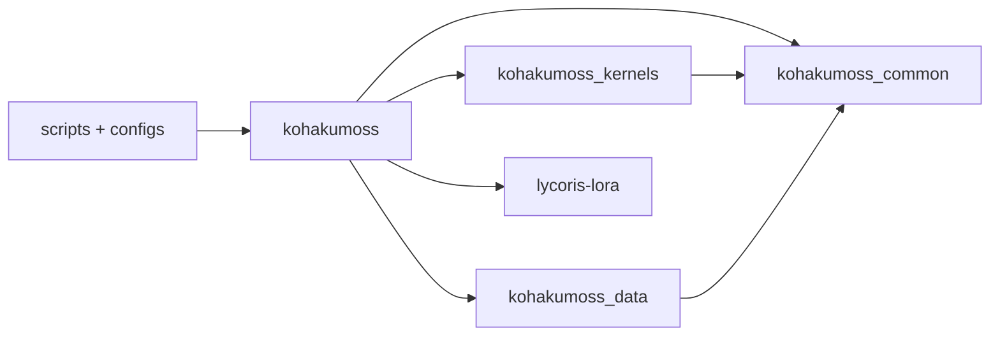
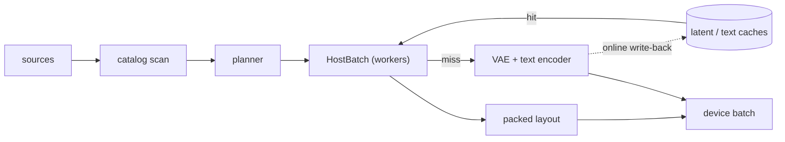
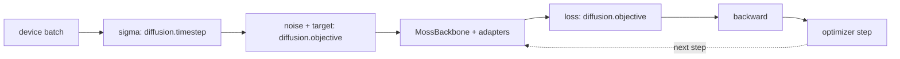
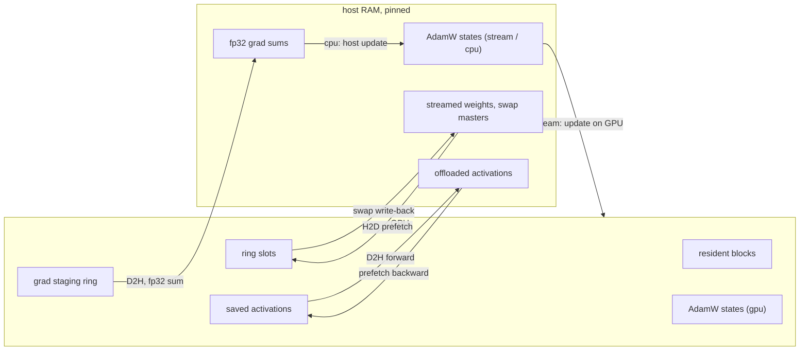
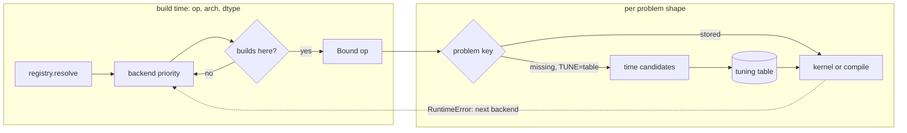
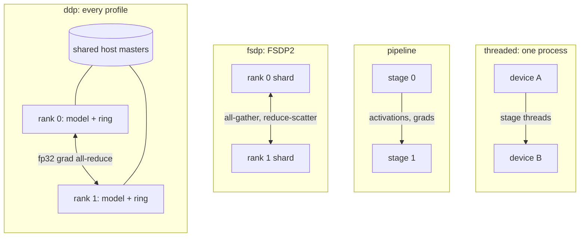

# KohakuMoss

A finetuning framework for [MOSS-Image](https://huggingface.co/OpenMOSS-Team/MOSS-Image-Base)
(MOSS-Image-Base / -SFT): every LyCORIS algorithm and full finetune on text-image data at
native resolutions, plus inference, on Windows and Linux, from 6 GB cards to multi-GPU
nodes.

- **Adapters and full finetune.** LoRA / LoCon, LoHa, LoKr, DoRA, OFT, BOFT, GLoRA, IA3,
  DyLoRA, T-LoRA through [LyCORIS](https://github.com/KohakuBlueleaf/LyCORIS) (its
  algorithms, save format and fused kernels), with dropouts, LoRA+, bypass or merged
  forwards and targeting presets; full finetune with Muon + AdamW and EMA after the MOSS
  tech report.
- **Own MOSS-Image implementation** on packed variable-length batches (one flat token
  axis, attention never crosses a sample), checked against the official code: fp32
  forward relative error 4.7e-6, 50-step sampling LPIPS 2.3e-6.
- **Kernels per GPU arch.** TileLang for sm70 / sm75, Triton for sm80+ and Intel Arc;
  varlen attention, the block ops and fused linears. Each op is bound per arch, dtype and
  shape to the faster of its kernel and `torch.compile`, measured once per card and
  stored in a tuning table.
- **Precision.** bf16, and fp16 for cards without bf16 (with an fp16 residual fix);
  fp8 and MXFP8 compute (sm89+) for the DiT and the text encoder in training and
  inference; int8 / fp8 weight-only frozen bases. Matmuls take 16-bit inputs with fp32
  accumulation; no fp64 anywhere.
- **Memory profiles** from `speed` to `minimal`, a 240-entry catalog, or manual knobs:
  checkpointing, weight streaming, activation offload, gradient offload, host optimizer
  states. Adapter training fits 8 GB and 6 GB cards; full finetune fits one 24 GB card
  with host masters.
- **Native-resolution data.** kohya / folder / jsonl / parquet / webdataset / native
  shard sources, a cached incremental catalog, resize / bucket / crop planners, token
  batching, offline and online latent / text caches; a plan that is a pure function of
  the data, the seed and the knobs, so a resume replays it exactly.
- **Multi-GPU (Linux).** DDP under every memory profile (weight streaming included),
  FSDP2, pipeline and threaded pipeline.
- **Exports.** LyCORIS files, ComfyUI-format adapters (the key layout of ComfyUI's
  MOSS-Image model, plus its fused q/k/v repack), merged and diffusers transformers.
- **Configs.** Every script is a [KohakuEngine](https://github.com/KohakuBlueleaf/KohakuEngine)
  (`kogine`) script: settings are module-level knobs, configs compose preset layers, and
  `kohakumoss-config` writes a checked config for your GPU and dataset.

## Install

torch comes from the PyTorch index that matches your GPU and driver; the install helper
detects both, installs torch from that index, then KohakuMoss with its default extra,
then runs `kohakumoss-doctor`, which lists anything missing with the command that fixes
it. Requirements: Python 3.10+ (the helpers make a 3.12 venv), an NVIDIA driver for CUDA
12.6+ or the Intel Arc driver; on Windows the Visual Studio Build Tools ("Desktop
development with C++"); for sm70 / sm75 the CUDA toolkit (`nvcc`).

Windows (PowerShell):

```powershell
git clone https://github.com/KohakuBlueleaf/KohakuMossTrainer; cd KohakuMossTrainer
powershell -ExecutionPolicy Bypass -File scripts\install\install.ps1
Set-ExecutionPolicy -Scope CurrentUser RemoteSigned   # once per user, so Activate.ps1 may run
.venv\Scripts\Activate.ps1                            # in cmd: .venv\Scripts\activate.bat
```

Linux:

```bash
git clone https://github.com/KohakuBlueleaf/KohakuMossTrainer && cd KohakuMossTrainer
bash scripts/install/install.sh
source .venv/bin/activate
```

By hand (here CUDA 13 drivers; `nvidia-smi` prints yours: cu126 / cu128 / cu130), from
PyPI or, with `-e ".[cuda]"`, from a clone; LyCORIS (`lycoris-lora>=4.1.2`) comes with
the package:

```bash
uv venv -p 3.12
uv pip install "torch>=2.13,<2.15" torchvision --index-url https://download.pytorch.org/whl/cu130
uv pip install "kohakumoss[cuda]" "torch>=2.13,<2.15" --extra-index-url https://download.pytorch.org/whl/cu130 --index-strategy unsafe-best-match
```

Intel Arc, Google Colab, the extras and the Triton / TileLang toolchains:
[docs/guides/install.md](docs/guides/install.md); Windows details and the feature
matrix: [docs/guides/install-windows.md](docs/guides/install-windows.md).

## Quick start

From the repository root, with the venv active (the same commands in PowerShell, `cmd`
or bash):

```bash
# 1. check the environment
kohakumoss-doctor

# 2. weights (~26 GB)
hf download OpenMOSS-Team/MOSS-Image-Base --local-dir models/MOSS-Image-Base

# 3. a config for this GPU and your dataset (kohya-style folders; --source for others)
kohakumoss-config new train --weights models/MOSS-Image-Base --data path/to/dataset --name my-lora

# 4. data: check the plan, then cache text embeddings and latents once
kogine run scripts/data/inspect_data.py --config configs/user/my-lora_data.py
kogine run scripts/data/cache_text.py --config configs/user/my-lora_data.py
kogine run scripts/data/cache_latents.py --config configs/user/my-lora_data.py

# 5. train (any knob on the command line: --set LR=2e-4 --set STEPS=2000)
kogine run scripts/train/moss.py --config configs/user/my-lora.py

# 6. sample with the exported adapter
kohakumoss-config new sample --weights models/MOSS-Image-Base --adapter runs/moss/my-lora/export/my-lora-comfy.safetensors --name my-lora-sample
kogine run scripts/sample/sample.py --config configs/user/my-lora-sample.py --set PROMPT="a lighthouse on a rocky coast at sunset"

# 7. export any checkpoint again (LyCORIS / ComfyUI / merged / diffusers)
kogine run scripts/export/export.py --set WEIGHTS=models/MOSS-Image-Base \
    --set ADAPTER=runs/moss/my-lora/checkpoints/step_00001000/trainable.safetensors --set OUT=my-lora.safetensors
```

The run writes `runs/moss/<RUN_NAME>/`: `log.txt`, `metrics.jsonl`, samples, checkpoints
and `export/` (the `comfy` and `lycoris` files). `kohakumoss-config wizard` asks for the
GPU, algorithm, data and weights instead of flags; `kohakumoss-config new --from
lora_24g_bf16 my_run.py` extends a fixed recipe (`configs/moss/recipes/`) with every
knob listed.

For a run from a handful of options, the example scripts write the config, check it and
run it, one PowerShell and one bash file each
([scripts/examples/README.md](scripts/examples/README.md)):

```powershell
.\scripts\examples\train.ps1 -Weights models\MOSS-Image-Base -Dataset D:\data\my_set -Steps 30 -SampleEvery 10
.\scripts\examples\sample.ps1 -Weights models\MOSS-Image-Base -Adapter runs\examples\train\<run>\export\<run>-lycoris.safetensors
.\scripts\examples\grid.ps1 -Weights models\MOSS-Image-Base -Run <run> -Checkpoints -Prompt "a lighthouse at dusk"
```

The walk-through is [docs/guides/first-lora.md](docs/guides/first-lora.md); sampling is
[docs/guides/inference.md](docs/guides/inference.md), full finetune
[docs/guides/full-finetune.md](docs/guides/full-finetune.md).

## Supported GPUs

By compute capability; the kernel column is the arch's first backend
(`kohakumoss_kernels.registry.DEFAULT_PRIORITY`), followed by the others in order.

| arch | kernels | compute dtype | fp8 / MXFP8 compute | this release | examples |
| --- | --- | --- | --- | --- | --- |
| sm70 Volta | TileLang, then Triton, compile, eager | fp16 | - | tested (1) | Tesla V100 |
| sm75 Turing | TileLang, then Triton, compile, eager | fp16 | - | tested | RTX 2080 Ti, Tesla T4 / T10 |
| sm80 / sm86 Ampere | Triton, then TileLang, compile, eager | bf16, fp16 | - | tested (sm80, sm86) | A100; RTX 3060 / 3090 |
| sm89 Ada | Triton, then TileLang, compile, eager | bf16, fp16 | fp8; MXFP8 on the fp16 MMA | tested | RTX 4090, L4 |
| sm90 Hopper | Triton, then TileLang, compile, eager | bf16, fp16 | fp8; MXFP8 on the fp16 MMA | supported, not tested | H100 |
| sm100 Blackwell | Triton, then TileLang, compile, eager | bf16, fp16 | fp8, MXFP8 (block-scaled MMA) | supported, not tested | B200 |
| sm120 Blackwell | Triton, then TileLang, compile, eager | bf16, fp16 | fp8, MXFP8 (block-scaled MMA) | tested | RTX 5090, RTX PRO 6000 Blackwell |
| Intel Xe (XPU) | Triton (Intel), then compile, eager | bf16 | - | supported, not tested | Arc B-series |

(1) Tested during this release's development (training runs, DDP, the low-VRAM layers,
the sm70 kernel suite); the final release tree's test suite was not re-run on sm70 (test
host offline at release time).

Windows targets are sm75, sm86, sm89, sm120 and Intel Arc: every single-GPU feature runs
on Windows; multi-GPU training is Linux-only. Each op of a
card runs its kernel or `torch.compile`, whichever is measured faster there; the eager
path is the reference both are checked against
([docs/performance/](docs/performance/README.md)).

## Memory profiles and VRAM

`kohakumoss-config new train` reads the GPU's memory and composes a VRAM layer:

| layer | for | memory profile | tokens per batch | encoders |
| --- | --- | --- | --- | --- |
| `vram_24g` | 24 GB | `balanced` (block checkpointing, 16 resident blocks, the rest streamed) | 12288 | text encoder streamed |
| `vram_16g` | 16 GB | `low` (4 resident blocks, activation offload, host AdamW states) | 8192 | text encoder streamed |
| `vram_12g` | 12 GB | 4 resident blocks, activation and gradient offload, host states | 6144 | text encoder streamed, VAE offloaded |
| `vram_8g` | 8 GB | `minimal` (2 resident blocks, activation and gradient offload, host states) | 4352 | text encoder streamed, VAE offloaded and tiled |
| `vram_6g` | 6 GB | 2 resident blocks, activation and gradient offload, AdamW on the host | 4352 | offline latent and text caches |
| `vram_auto` | above 24 GB | `auto`: the fastest profile whose estimate fits | | `auto` |
| `vram_24g_full` | full finetune, 24 GB | swapped blocks with host fp32 masters and states | 8192 | text encoder streamed |

The small layers keep the DiT in host memory. For `8g` plan about 19 GiB of host RAM
during the steps and about 32 GiB at build, when the 15.63 GiB text encoder loads to
encode the sample prompts (the base samples every 500 steps); with `--set
SAMPLE_EVERY=0` and both caches offline the text encoder never loads, so the build
peak is the step figure. The single-GPU full finetune needs about 70 GiB during the
steps and 88 GiB at build ([configs.md#host-ram](docs/guides/configs.md#host-ram)). The four named profiles and
the whole catalog, with their estimated peaks:
[docs/concepts/profiles.md](docs/concepts/profiles.md).

<!-- release-tables:speed-vram:begin -->
**Measured speed and VRAM per GPU and layer.** This table is filled from the release
bench matrix: GPU, VRAM layer, precision, s/step, samples/s, nvidia-smi peak and steady VRAM.
<!-- release-tables:speed-vram:end -->

<!-- release-tables:inference:begin -->
**Measured sampling speed and VRAM per GPU.** This table is filled from the release
bench matrix: GPU, memory profile, base precision, s/step at 1024^2, nvidia-smi peak.
<!-- release-tables:inference:end -->

## Architecture

Four packages under `src/`; scripts and configs sit on top:



| package | subpackages and modules |
| --- | --- |
| `kohakumoss` | model, encoders, adapters, diffusion, training, memory, precision, offload, parallel, quant, tuning, inference, logging, cli, types, probe |
| `kohakumoss_kernels` | ops, registry, status, backends (eager, compile, Triton, TileLang), fp8, quant, optim, tuning, hardware, error_stats |
| `kohakumoss_data` | format, sources, scan, catalog, caption, resolution, loader, cache |
| `kohakumoss_common` | log, registry, imports, knobs, io, units, devices |
| `lycoris-lora` | the adapter algorithms, their save format and fused kernels |

The data path: the planner fixes each batch from the data, the seed and the knobs; the
loader workers materialise it; the encoders run only for what the caches do not hold
(placed by `VAE_ENCODE` / `TEXT_ENCODE`):



The step: the backbone is a pure function `MossBackbone(img, text, sigma, seq) -> v`, and
the objective lives outside it:



The memory plan resolves once at build time and installs its engines; nothing branches
on it per step:



Kernel selection is a build-time choice per op, arch and dtype, then per problem shape
from the card's tuning table. The arch's backend priority is TileLang first on sm70 /
sm75, Triton first on sm80+ and XPU, then `torch.compile`, then eager (the reference,
never timed):



Multi-GPU training (Linux) is one of four engines, launched by the train script itself:



The design of each part is in [docs/](docs/README.md): concepts (model, data, adapters,
training, profiles, numerics), guides, internals (kernels, tuning, offload, text
encoder, quantized kernels, distributed launch) and the performance tables.

## Docs

[docs/README.md](docs/README.md) indexes everything; every script is listed in
[docs/guides/scripts.md](docs/guides/scripts.md).

## Contributing

Read [CONTRIBUTING.md](CONTRIBUTING.md) before opening an issue or a PR: feature PRs need an
approved issue first, and the code conventions are in [CLAUDE.md](CLAUDE.md). Participation
follows the [Code of Conduct](CODE_OF_CONDUCT.md).

## License

The [KohakuMoss License 1.0](LICENSE): the Apache License 2.0 with one additional term. A
derivative work, package, product or service built on KohakuMoss must include "Kohaku" in
its name. Models, adapters and images you train or generate with it are not affected.
