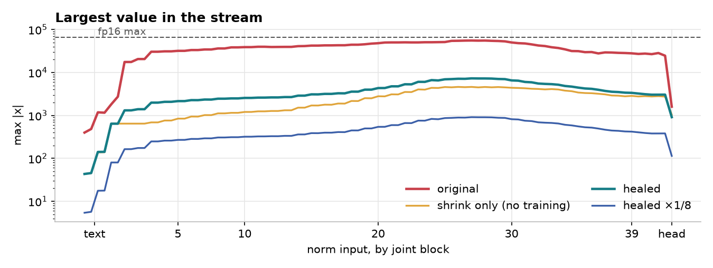
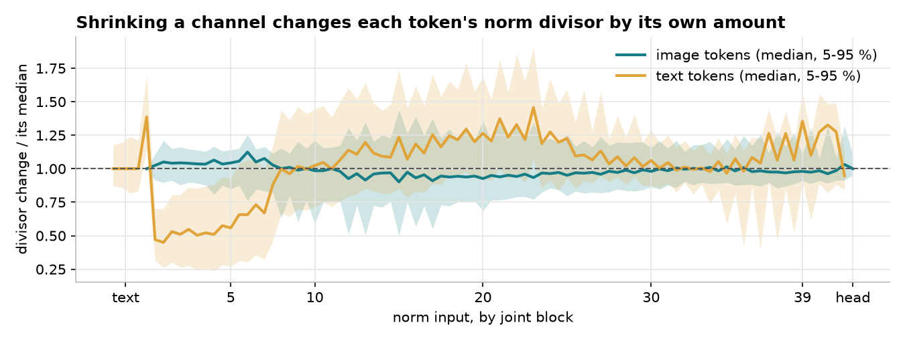
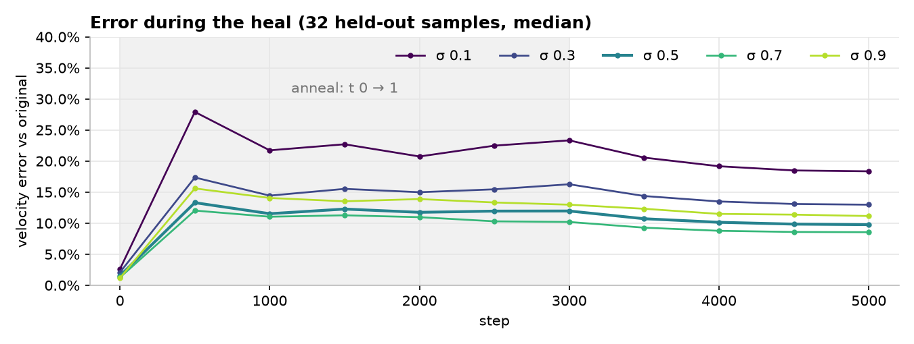
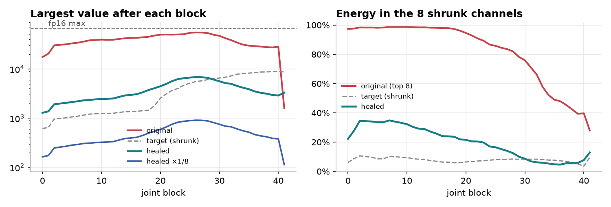
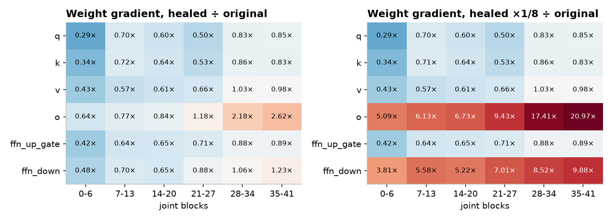

# Massive residual channels in MOSS-Image

The MOSS-Image base DiT keeps almost all of its residual-stream energy in a handful of
its 3,072 channels. This page shows what those channels are, why removing them breaks
the model, and how an annealed heal removes most of them while the model keeps its
outputs. The figures are measured on the base model and on the healed model, on held-out
text-image samples at 512².

## The finding in one table

| | original | healed (heal5k) | healed ×1/8 |
| --- | --- | --- | --- |
| largest channel (1356), peak RMS ÷ median channel | 505× | 39× | 39× |
| energy in the 8 largest channels, block 10 | 98.7 % | 38.2 % | 38.2 % |
| largest value in the stream, block 10 | 38,912 | 2,555 | 319 |
| largest value anywhere in the stream (fp16 max 65,504) | 55,424 | 7,287 | 911 |
| velocity error vs the original, σ 0.5 | 0 | 10.1 % | 10.1 % (same outputs) |
| flow loss on real data vs the original, σ 0.5 | 0 | +2.2 % | +2.2 % |

The healed model is the step-4,000 snapshot of the heal below.


*Top: original. Bottom: healed. Same prompt, seed and sampler (16 steps, CFG 3, 1024²).
The anime, interior and watercolour prompts hold; the photographic fox loses anatomy.*

## 1. A few channels are huge


At every norm input, measure each channel's RMS over all tokens and divide by the median
channel. Channel 1356 peaks at 505× the median, channel 42 at 99×, and about 30 more sit
between 10× and 30×. The same channels are huge in every block from the first joint
block to the last.


Those 8 channels carry 96–99 % of the stream's energy from joint block 1 through block
20, and still about half at block 35. The text refiner (left) is the only part where
they are not dominant yet.



The largest values reach 55,424, 85 % of the fp16 maximum. This is why fp16 inference
and training of MOSS-Image needs the residual fold of `FP16_FIX`
([numerics.md](numerics.md)).

## 2. What the channels do

Every block reads the stream through an RMSNorm:
`norm(x) = w * x / rms(x)`. When one channel holds almost all of a token's energy,
`rms(x)` is set by that channel alone. The massive channel then works as a **per-token
volume knob**: by writing more or less into channel 1356, a block sets how loud every
other channel of that token is for the next block.

This is a general property of residual networks with pre-norm blocks, not something
specific to MOSS: a small pre-norm DiT trained from scratch grows the same gain channels
within minutes. In that small model:

- a final norm before the head is not needed for the channels to appear;
- weight decay lowers their scale but keeps them;
- a penalty on the top-channel energy share removes them, at a cost in task loss
  (a penalty weight of 0.1 cost +8 % loss);
- detaching the norm's denominator from the gradient makes the stream explode.

So the channels are a feature the model relies on, not dead weight. Removing them
removes a gain path the model uses, and that path has to be replaced.

## 3. Shrinking them without training does not work

The direct fix scales each massive channel down by a factor `D_c` in every writer (the
embedders, `o`, `ffn_down`), and gives every reader norm a gain that undoes the average
change of its divisor. With `tau 16` (shrink every channel above 16× the median, 8
channels) the stream's largest value drops 12× and the energy share drops to 20 %.



It still moves the output by 41 % (median velocity error; 48 % at `tau 8`, 57 % at
`tau 4`). The divisor change is different for every token: across the joint blocks, the
5–95 % range of image tokens spans 0.50× to 1.44× of the median change, and text tokens
0.24× to 1.90×, even at the gentlest setting. One fixed gain per norm cannot undo a per-token
change, and every block applies it again on top of the last.

An exact alternative keeps the divisor of the shrunk stream equal to the old one: a
**weighted RMSNorm** whose mean square weighs channel `c` by `1 / D_c²`. Its output is
identical to the original's and its values stay inside fp16. It changes nothing about
how the model learns, because the per-token gain path is still there, only computed
differently.

## 4. The annealed heal

The heal starts from the exact model and moves it to a plain one while training keeps it
close to the original:

1. **Exact start.** The shrunk model (tau 16) with weighted norms, weight
   `λ_c = (1 / D_c²)^(1 − t)`, at `t = 0` it equals the original.
2. **Anneal.** `t` goes from 0 to 1 over the first 3,000 steps. The norm weights fade
   to 1; each norm's gain takes the matching share of its calibrated divisor ratio
   `r̄`: `gain = w / (D · r̄^t)`.
3. **Learn the rest.** While `t` rises, training replaces the lost gain path:
   - writers (`o`, `ffn_down`): full finetune, lr 3e-5;
   - readers (`q`, `k`, `v`, `ffn_up_gate`): LoKr factor 8, lr 5e-4;
   - norm gains: lr 2e-3;
   - loss: relative squared error between the student's and the original's velocity,
     on the same noised inputs (pure distillation).
4. **End.** At `t = 1` the norms are plain RMSNorms again; the result is a standard
   MOSS-Image DiT file that loads anywhere the original does.

Run: 5,000 steps of 8 samples at 512², 4× RTX 3090, the original as a bf16 teacher
streamed per block, the student in bf16 with block checkpointing.



| step | σ 0.1 | σ 0.3 | σ 0.5 | σ 0.7 | σ 0.9 |
| --- | --- | --- | --- | --- | --- |
| 3,000 (anneal ends) | 23.3 % | 16.3 % | 12.0 % | 10.2 % | 13.0 % |
| 4,000 | 19.2 % | 13.5 % | 10.1 % | 8.8 % | 11.5 % |
| 5,000 | 18.3 % | 13.0 % | 9.8 % | 8.5 % | 11.1 % |

Velocity error against the original, median over 32 held-out samples. On real data the
step-4,000 model's flow loss is 1.9–3.8 % above the original's, depending on σ. The
error is still falling at step 5,000; the heal is not converged.

### What the healed stream looks like



At step 4,000 the largest value per block is 1,300–6,800, against 18,000–55,000 in the
original. The 8 shrunk
channels come back to 20–35 % of the energy in the first 20 blocks (the shrunk target
holds 6–11 %): training grows part of the gain path back in the same channels. That
share is flat from step 3,000 on.

## 5. Rescaling the whole stream

After the heal the stream's RMS runs from 4 to 61. Scaling the embedders and every
writer by `c = 1/8` and every norm eps by `c²` multiplies the stream by exactly 1/8 and
leaves every norm output, and so the velocity, unchanged (difference 0 in bf16). The
shares and channel ratios do not change either; only the size does: the largest value
drops to 911, 1.4 % of the fp16 maximum.

The rescale changes how the model learns. Readers see the stream only through a norm,
so their gradients are unchanged. Writers produce the stream: their gradient grows ×8
while their weights shrink ×8.

| weights | gradient | weight size | gradient ÷ weight |
| --- | --- | --- | --- |
| readers (`q`, `k`, `v`, `ffn_up_gate`), norm gains | unchanged | unchanged | unchanged |
| writers (`o`, `ffn_down`), embedders | ×8 | ×1/8 | ×64 |

Measured on the flow-matching loss (8 held-out samples at σ 0.3 and 0.7, median over
the linears of each depth band):



The ×1/8 copy's gradient is exactly 1.00× the healed model's on every reader and 8.00×
on every writer, in every band. The heal itself already moved the gradients: the
readers' gradients are 0.3–1.0× the original's (smallest in the first blocks), the
`o` gradients grow toward the last blocks (2.6× in blocks 35–41).

With Adam each step has about the same absolute size, so the same step on 8× smaller
writers is an 8× larger relative change:


*The same small random update applied to one depth band's writers (left) or readers
(right); bars are the relative change of the velocity it causes.*

In the original model one update moves the output by 1.2–1.6 % whichever band and
whichever kind of weight it touches. After the rescale, the same update on the last
band's writers moves it by 23 %.

### The fp16 fix is a rescale too

`FP16_FIX` ([numerics.md](numerics.md)) scales the stream for the same reason, with two
different effects on training:

- `FP16_FIX="online"` applies the scale at run time as constants (gate multipliers,
  writer input scales, eps). The stored weights stay as they are, so no weight's
  gradient or update size changes: it is a numerics fix only.
- A fold written into the weights (an fp16-fix weights file) scales the stored
  parameters it touches. With a pre-gate scale `s` on `o` / `ffn_down`, those writers
  are stored `s` times smaller and train like the ×1/8 copy above. Adapter exports undo
  the fold, so exported adapters stay in the original weight space.

## 6. Keeping the channels from coming back

`CONCENTRATION_LOSS = {"weight": w, "k": k}` adds `w` times the mean, over the joint
blocks, of the share of block-output energy in the `k` largest channels
([training.md](training.md#stream-penalties); `STREAM_LOSS` also holds a soft cap on
the stream's peak values). It puts a price on regrowing the
channels during finetuning. Keep the weight small: in the small pre-norm DiT a weight
of 0.01 kept the top-8 share at its starting value for +1.7 % loss, while 0.1 cost
+8 %. On the healed model, a LoKr finetune with weight 0.01 and `k = 32` held the top-32
share at 0.21–0.23 over 2,700 steps, down from 0.32 at the start.

The heal takes the same penalty as `CONC_WEIGHT` / `CONC_K` (below), on the student's
block outputs next to the distillation loss.

## Running the heal

`kohakumoss.heal` implements every step above; five scripts under `scripts/heal/` run
them. Model, kernel and memory knobs come from a training config (`TRAIN_CONFIG`), so
the teacher and the student are built and placed exactly as a training run builds its
model.

| step | script | writes |
| --- | --- | --- |
| 1. records | `cache.py` | per dataset row: planned latents and caption embedding (`part*.pt`), the empty-prompt embedding |
| 2. calibration | `calibrate.py` | report: the 32 largest channels, per tau the shrink scales D, each norm's divisor ratio r̄, the training-free shrink's stream stats and velocity error |
| 3. heal | `heal.py` | `heal.json`, `metrics.jsonl` (per step), `evals.jsonl` (held-out), `grads.json`, `step_<n>/` snapshots, `final/` |
| 4. merge | `merge.py` | one plain single-file DiT from a parts directory at t = 1 |
| 5. rescale | `rescale.py` | the ×c copy (c the power of two nearest 1 / the stream RMS) and its exactness report |

```bash
kogine run scripts/heal/cache.py --set TRAIN_CONFIG=my_run.py --set OUT=heal/records \
    --set ROWS=17000 --set PART=0 --set PARTS=4          # one process per GPU, PART 0..3
kogine run scripts/heal/calibrate.py --set DIT=moss_image_base_bf16.safetensors \
    --set RECORDS=heal/records --set OUT=heal/calibration.json
kogine run scripts/heal/heal.py --config configs/heal/recipes/recipes_anneal_5k_4x24g.py \
    --set TRAIN_CONFIG=my_run.py --set TEACHER=moss_image_base_bf16.safetensors \
    --set REPORT=heal/calibration.json --set RECORDS=heal/records --set OUT=heal/runs/heal5k
kogine run scripts/heal/merge.py --set RUN=heal/runs/heal5k --set OUT=healed.safetensors
kogine run scripts/heal/rescale.py --set DIT=healed.safetensors --set RECORDS=heal/records \
    --set OUT=healed_x8.safetensors
```

How the run is built:

- **Student.** `STUDENT` (the teacher's file when empty), loaded with LoKr adapters and
  `TRAIN_NORMS` gain deltas. With `REPORT` set, the writers are scaled by D and the norm
  gains by 1 / D in place, and the student's norms are bound to the weighted RMSNorm ops
  (`kohakumoss.heal.wnorm`) through its `OpSet`; nothing in the model is patched.
- **Anneal.** Each step sets `t = min(1, step / ANNEAL_STEPS)`: the norm channel weights
  become (1 / D²)^(1 − t) and every gain g0 · r̄^−t (`ANNEAL_RBAR`; r̄ = 1 otherwise).
  `ANNEAL_STEPS = 0` starts at t = 1; without `REPORT` the student starts from its file
  as it is (a second heal stage from a healed model).
- **Trainables.** `MODE="full_writers"`: `o` / `ffn_down` in full (AdamW16, stochastic
  rounding, `LR_FULL`), LoKr factor `LOKR_FACTOR` on `q` / `k` / `v` / `ffn_up_gate`
  (AdamW, `LR_LOKR`); `MODE="lokr"`: LoKr on `LOKR_TARGET` only. The norm-gain deltas
  always train (AdamW, `LR_NORM`). Warmup, then cosine to 1 %.
- **Loss.** relative squared error between the student's and the teacher's velocity on
  the same noised records, plus `HARD_WEIGHT` × the relative error against the flow
  target, plus `CONC_WEIGHT` × the top-`CONC_K` channel share of the student's block
  outputs.
- **Placement.** `TEACHER_MEMORY` / `STUDENT_MEMORY` are memory knobs layered on the
  training config (the recipe: the teacher streamed through a two-slot block ring, the
  student resident with block checkpointing). Ranks are spawned per `DEVICES` and
  all-reduce their gradients each step.
- **Evaluation.** Every `EVAL_EVERY` steps, on the `HELD` held-out records at σ 0.1 … 0.9
  with fixed noise: velocity error against the teacher, both flow losses, per-block
  stream stats of the student and of the D-scaled teacher, gain and writer drift. The
  gradient map (`GRAD_MAP`) is taken before the first step and after the last.
- **Merge.** The student file with the shrink rebuilt at t = 1 (writers × D, gains
  w / (D r̄)), the trained writers, then the LyCORIS file merged: a standard DiT file.

## Open points

- The heal is not converged: the error is still falling at step 5,000.
- The shrunk channels regrow to 20–35 % of the energy during the heal; a heal with the
  concentration penalty and a real-data loss next to the teacher loss is the next run.
- The heal ran at 512²; photographic prompts at 1024² lose the most.
